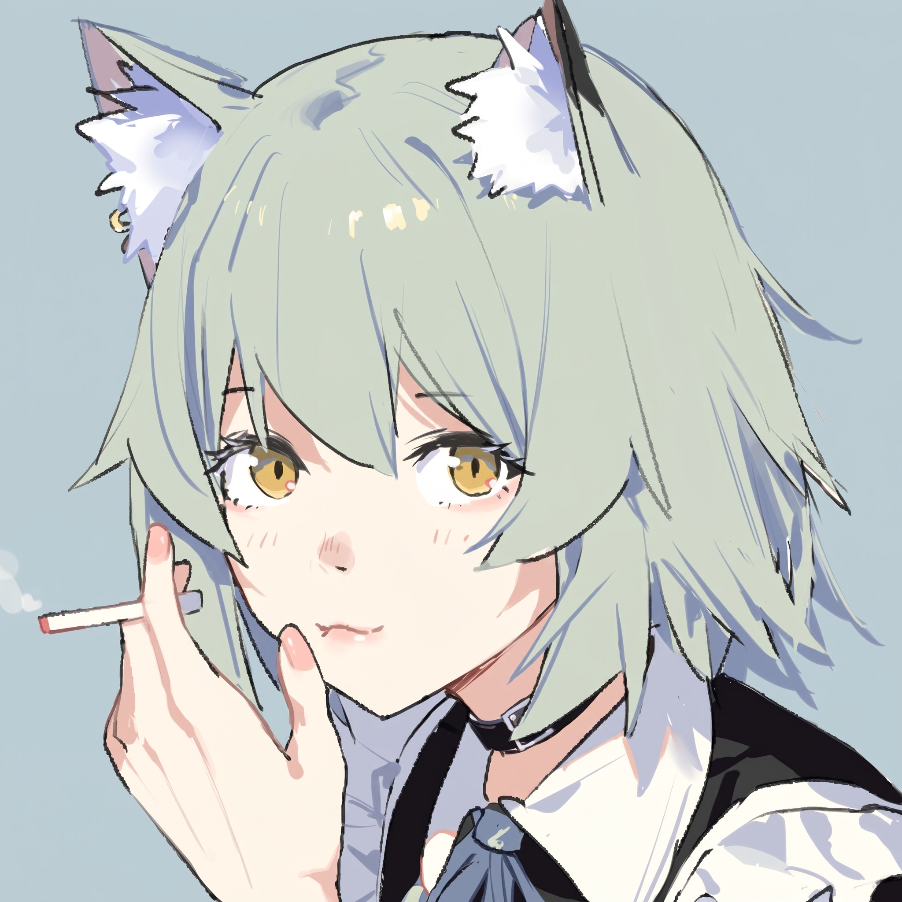
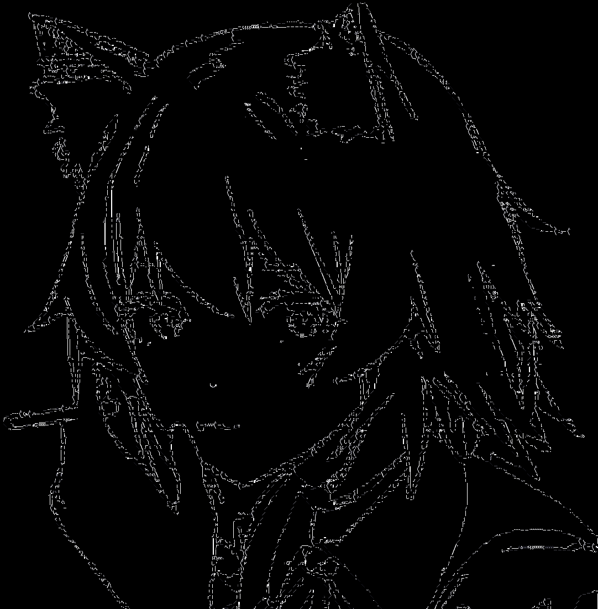
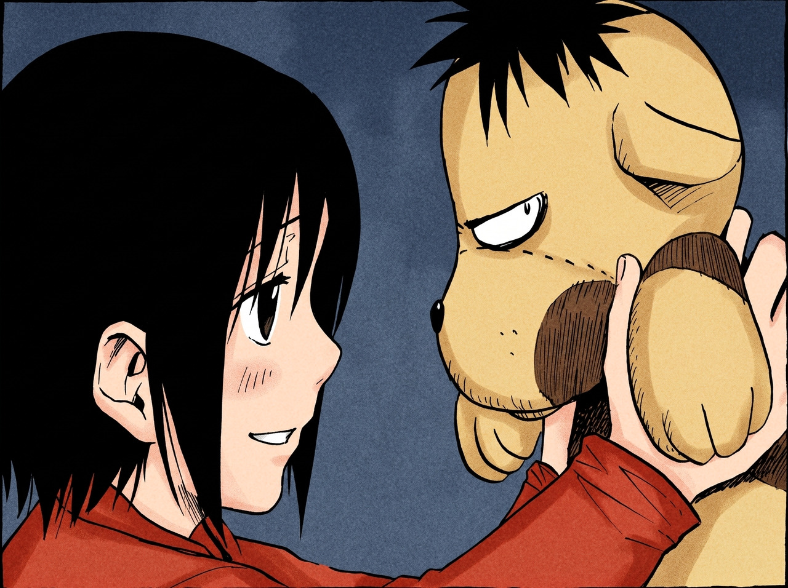
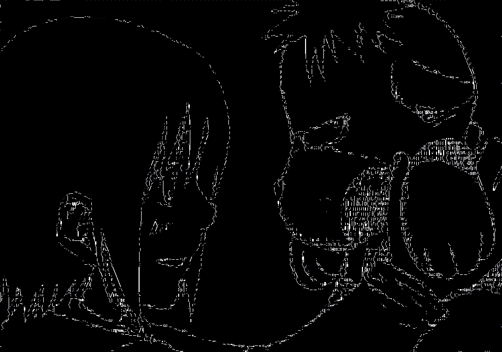
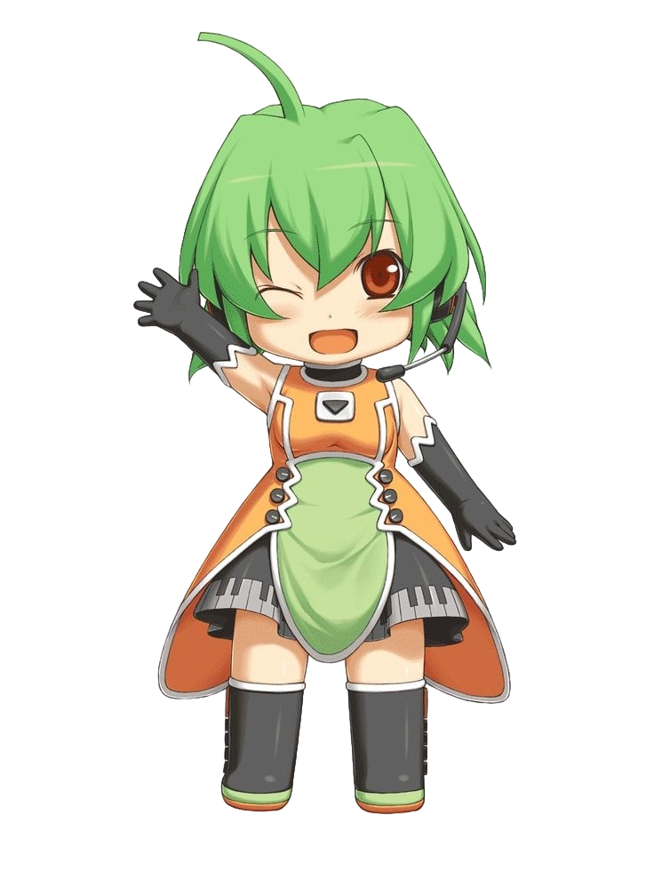
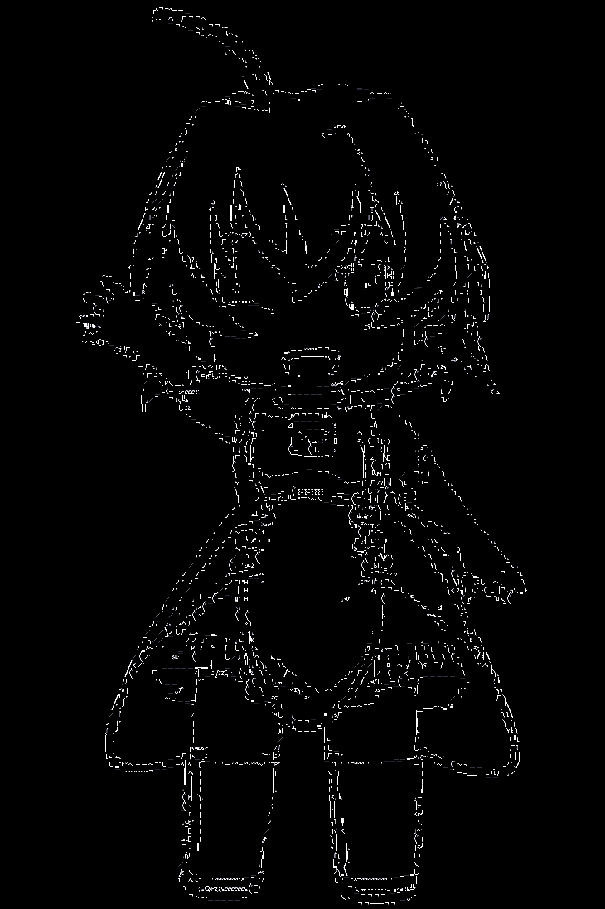

# Glyphomania

Glyphomania turns a flat-color image (line art, comic-style drawing, cel shading) into **ASCII & Unicode art**.

It does not use brightness or "dark = dense character" logic like many ASCII converters. Instead it finds the **borders between color regions** and tries to cover each border with the character whose shape fits best. Character shapes come from [GNU Unifont](https://unifoundry.org/unifont/), a bitmap font, so the program knows exactly which pixels every glyph has.

---

## Contents
1. [Gallery](#gallery)
2. [What it is good for](#what-it-is-good-for)
3. [Limits of this approach](#limits-of-this-approach)
4. [How it works](#how-it-works)
5. [Project structure](#project-structure)
6. [Building](#building)
7. [Usage](#usage)
8. [Tuning guide](#tuning-guide)
9. [Credits and licenses](#credits-and-licenses)

---

## Gallery

<p align="center">
  
  
</p>
<p align="center">
  
  
</p>
<p align="center">
  
  
</p>


---
## What it is good for
**1. Converting comic-style images.**
Images with a small number of flat colors and clear borders give the best results: manga panels, cartoon characters, logos, icons, flat illustrations. Fewer micro details and gradients = better.

**2. Making a base for hand-made ASCII art.**
You can draw rough shapes with flat fills in any image editor, run them through Glyphomania, and get a text file that already has the correct layout and proportions. Then you refine it by hand in an ascii art text editor. This is 100% faster than placing every character yourself.


---

## Limits of this approach

Please read this before you try a photo.

Glyphomania reduces the picture to a few flat-color regions and then draws only the **borders** of these regions. This design is the reason why it is decent at anime, and also the reason why it is bad at many other things:

- **Photos and gradients.** A smooth gradient has no real border. The color quantization (k-means) cuts it into a few bands, and the borders between bands are arbitrary. You get contour-map lines that do not follow any object in the picture.
- **Texture and noise.** Skin, grass, fabric, film grain, and JPEG artifacts create thousands of tiny regions. A small denoise window leaves them in. A big denoise window removes them together with the real details.
- **No shading.** Dark and bright areas are not shown with dense and light characters. The inside of a region is always empty space; only its outline is drawn.
- **More colors do not fix it.** Raising `--k-means-colors` to catch more detail creates many more outlines, and the processing time grows with the number of colors, because each color is a full matching pass.

---

## How it works

The program prints 13 steps when you use `--visualize-steps`. This is what they do.


- **01 Select glyphs.** The glyph set (the built-in one, or your file from `--glyphset`) is looked up in `glyph_bitmap.bin` (embedded). For every glyph it holds a distance map: an 8 x 16 grid where each number is the distance from that pixel to the nearest ink pixel of the glyph. This makes matching tolerant, because a line that is one pixel off costs only a little instead of counting as a total miss. A wide glyph covers two cells, so it is stored as a left half and a right half.
- **02 Downsample.** The image is resized to `--downsample-res` with area averaging (every new pixel is the average of the source area it covers). By default this is the input size, but never larger than the final character grid in pixels.
- **04 Palette.** The colors are grouped into 64 bins (4 levels per channel). The start palette takes the darkest color, the lightest one, and then repeatedly the color that is farthest from all colors already chosen.
- **05 K-means.** The start palette is refined for 10 iterations into `--k-means-colors` colors, and every pixel gets the color of its nearest cluster. After this step the image has only N exact colors, sorted from the most to the least common.
- **07 Denoise.** Every pixel is replaced with the most common color in a square window around it. You can give several window sizes; each pass works on the result of the previous one. This removes specks and smooths jagged borders.
- **09 Blobs.** Steps 09 to 11 repeat for each color, most common first. The program makes a mask of the pixels with exactly this color, scales it up to the full character grid (`width x 8` by `height x 16` pixels), and keeps only its outline: the mask pixels that touch a pixel outside the mask.
- **10 Accumulate.** The outlines of all colors are merged into one binary image. It is used only for the `Binary.pbm` debug file.
- **11 ASCII.** The outline image is cut into 8 x 16 cells. A cell with fewer edge pixels than `--ascii-threshold` stays empty. For the other cells the program builds the same kind of distance map as in step 01, adds `--ink-bias`, and picks the glyph with the smallest sum of absolute differences. A wide glyph wins over two narrow ones if its difference is smaller than the narrow pair's difference plus `--wide-bias`. A cell that is already filled by an earlier color is not changed, so the most common color wins where two regions meet.
- **13 Output.** The text is written to a file in `--output-dir`, or to stdout. A wide glyph counts as two columns, so the text is exactly as wide as `--ascii-res`.

- Steps 03, 06, 08 and 12 only save debug images (`Downsampled.png`, `Quantised.png`, `Denoised.png`, `Binary.pbm`) when `-v` is used.

---

## Project structure

```text
glyphomania/
├── src/
│   ├── main.c            CLI parsing, glyph set loading, pipeline control, output
│   ├── ascii.c / .h      masks, edges, mask resampling, glyph matching
│   ├── filter.c / .h     area-average resize, palette, k-means, denoise
│   ├── image.c / .h      Image and Palette types, loading via stb_image
│   └── utils.c / .h      queue, BFS distance, small math helpers
├── tools/
│   ├── rodata_prepare.py generates glyph_bitmap.bin from Unifont.ttf
│   └── requirements.txt
├── resources/
│   ├── Unifont.ttf
│   └── glyph_bitmap.bin  distance maps, embedded into the program
├── external/
│   ├── stb_image.h
│   └── stb_image_write.h
├── docs/
│   └── images/           pictures for this README
├── CMakeLists.txt
└── README.md
```

---

## Building

### Windows support is untested

You need a compiler with C23 `#embed` support (Clang 19+ or GCC 15+).

1. Clone the repository:

   ```sh
   git clone https://github.com/definitely-me/glyphomania
   cd glyphomania
   ```

2. Build with CMake:

   ```sh
   cmake -B build
   cmake --build build
   ```

3. Optional: regenerate `resources/glyph_bitmap.bin`. The repository already contains it together with `Unifont.ttf`, so you only need this if you change the font or the generator. Run it from the project root, then rebuild, because the file is embedded into the program:

   ```sh
   pip install -r tools/requirements.txt
   python tools/rodata_prepare.py
   ```

---

## Usage

### My setup for viewing the result:
- **micro** as a text editor
- **GNU Unifont** as a font — highly recommended, as the program uses it for glyph matching

```sh
glyphomania --input <path> [--ascii-res <w> <h>] [options]
```

Minimal run (the text goes to stdout):

```sh
glyphomania -i input.png -a 200 100
```

Save to a file and export intermediate debug images:

```sh
glyphomania -i input.png -a 200 100 -c 3 -r 5 3 -o out -n result.txt -v
```

Full example (every effective option):

```sh
glyphomania --input input.png \
            --ascii-res 200 100 \
            --downsample-res 800 1000 --non-strict-downsample \
            --k-means-colors 3 \
            --denoise-radius 5 3 \
            --ascii-threshold 6 --ink-bias 3 --wide-bias 300 \
            --glyphset my_glyphs.txt \
            --visualize-steps \
            --output-dir ./out --name result.txt
```


| Flag | Description |
|------|-------------|
| `-i`, `--input <path>` | Input image path (required). Any stb_image format: JPEG, PNG, BMP, GIF, TGA, PSD, HDR, PIC, PNM |
| `-o`, `--output-dir <dir>` | Directory for the ASCII file and debug dumps (default: `./`). Without this option the ASCII art is printed to stdout and `--name` is ignored |
| `-n`, `--name <file>` | Output file name inside `--output-dir` (default: `ASCII.txt`) |
| `-g`, `--glyphset <path>` | UTF-8 text file with the glyphs to match against (default: built-in set). Spaces, tabs and newlines are ignored, duplicates are removed |
| `-a`, `--ascii-res <w> <h>` | ASCII grid size in characters (default: 300x100, max: 1024x1024). Each character cell is 8x16 px in full-res space |
| `-d`, `--downsample-res <w> <h>` | Pre-quantization working resolution (default: input image res). Clamped with a warning if larger than the input or the ASCII grid |
| `-nd`, `--non-strict-downsample` | Do not clamp `--downsample-res`: allow upscaling beyond the input and the ASCII grid. Slower, uses more memory, adds no detail, but can be used to tune denoise more precisely |
| `-c`, `--k-means-colors <n>` | Number of palette clusters (2-64, default: 4, recommended: 2-8) |
| `-r`, `--denoise-radius <n>...` | Odd values (1-99) for the denoise passes (default: 3). Each value is one pass, applied in the given order. Consumes values until the next flag (e.g. `-r 7 5 3`). Large values get slow quickly. Recommended: a decreasing cascade from 9 to 3. Value 1 changes nothing |
| `-t`, `--ascii-threshold <n>` | Minimum edge pixels in a cell required to pick a glyph instead of empty space (1-127, default: 4, recommended: 3-12) |
| `-b`, `--ink-bias <n>` | Biases the distance transform to shift glyph density/coverage (-20..20, default: 0). Negative values favor dense, noisy glyphs that fill more of the cell; positive values favor sparse, minimal glyphs |
| `-ew`, `--exclude-wide` | Do not use wide glyphs (they occupy two neighbouring cells, one half per cell). Off by default |
| `--wide-bias <n>` | Strength of the wide-glyph bias (0..1000, default: 300). Tune it if wide glyphs are picked too rarely or too often |
| `-v`, `--visualize-steps` | Export intermediate files (`Downsampled.png`, `Quantised.png`, `Denoised.png`, `Binary.pbm`) to `--output-dir` (default: `./`). Stage timings are also printed to stderr unless `--silent` is set |
| `-S`, `--silent` | Suppress warnings and stage timings (errors are still printed, the ASCII output is not affected) |
| `-bg`, `--builtin-glyphset` | Show the built-in glyph set |
| `-h`, `--help` | Show the help message|

---

## Tuning guide

Run once with `-v` and look at `Denoised.png`. If the shapes are wrong, tune `-c`, `-r` and `-d`; the other flags will not help. If the shapes are right but the text is wrong (broken lines, too noisy, too heavy), tune `-a`, `-t`, `-b`, `-g`, `-ew` and `--wide-bias`.

### `-a`, `--ascii-res <w> <h>`

The size of the result in characters. One cell covers 8 x 16 pixels, so it is twice as tall as it is wide, and **the image is stretched to the grid you ask for**. To keep the proportions:

```text
height = width * (image_height / image_width) / 2
```

### `-d`, `--downsample-res <w> <h>`

Quantization and denoise run at this resolution, not at the grid resolution, so the denoise window is measured in pixels of this image. A lower value is faster, and the same `-r` covers more of the picture (it is stronger). A higher value keeps more detail, and the same `-r` becomes weaker. If you change `-d`, check `-r` again. Can be used to reduce the amount of detail in a picture. Check `Downsampled.png` (with -v flag) to see what remains of the image.

### `-nd`, `--non-strict-downsample`

Allows `-d` values above the input size or the grid size. It adds no detail and is slower, but it gives finer control over denoise: an n-pixel window then covers a smaller part of the picture. Case: you use `-r 5 3` but the image has lost too much detail. With `-r 3` too much detail remains. You can increase resolution a bit with -nd and `-d` with higher dimensions => now `-r 5 3` is just fine.

### `-c`, `--k-means-colors <n>`

The number of flat colors the image is reduced to. For black-and-white line art use `2`.

Too low, and regions merge (their border disappears). Too high, and regions are split for no reason and you get extra outlines. Check `Quantized.png` (with -v flag) to see what colors are chosen and where the edges are.

### `-r`, `--denoise-radius <n>...`

Each number is the side of a square window in pixels (`3` means 3 x 3), so it must be odd. A bigger window removes bigger specks and smooths more, but it also erases thin lines and small details, and it is much slower.

Several values run as passes, in the given order. Large to small works well, for example `-r 9 5 3`. If you need something between 3 and 5, there is no 4, so use 3 several times: `-r 3 3`. Check `Denoised.png` (with -v flag) to see what remains of the image.

### `-t`, `--ascii-threshold <n>`

The minimum number of edge pixels out of 128 that a cell needs to get a glyph. Lower: short and thin lines survive, but dust appears. Higher: the picture is cleaner, but thin lines can disappear or look dashed. If lines are broken, lower it. If there is dust, raise it or add denoise. Check `Binary.pbm` (with -v flag) to see 8 x 16 cells that were converted to ASCII.

### `-b`, `--ink-bias <n>`

Added to every distance value of a cell before matching. Positive values favor sparse glyphs (thin strokes, small marks). Negative values favor dense glyphs that fill more of the cell, which makes the result heavier. Start at `0` and move in small steps.

### `-g`, `--glyphset <path>`

The glyph set defines the style. A small set (for example `/ \ | _ - ( ) .`) gives a clean, classic look with less accurate shapes. A large set (like the built-in one) gives more accurate outlines but a busier look. Keep some narrow glyphs in it, because the matcher needs them. Use `-bg` to print the built-in set as a starting point.

### `-ew`, `--exclude-wide`

Every character becomes exactly one column wide.

### `--wide-bias <n>`

A wide glyph replaces two narrow ones when its difference is smaller than the narrow pair's difference plus this value. Higher: more wide glyphs. Lower: fewer. At `0`, a wide glyph must be strictly better than the narrow pair. There is no universal value, so change it in steps of about 100. With `-v`, the last log line shows how many wide and narrow glyphs were used.

---

## Credits and licenses

- **GNU Unifont** by Roman Czyborra, Paul Hardy: <https://unifoundry.org/unifont/>  [SIL Open Font License 1.1](https://sil.org)
- **stb_image / stb_image_write** by Sean Barrett: <https://github.com/nothings/stb> [Public Domain](https://unlicense.org) / [MIT](https://opensource.org)
- **Glyphomania**: [MIT License](LICENSE)
